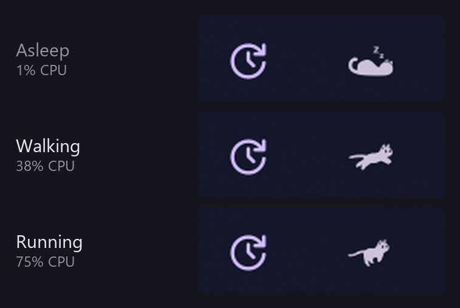
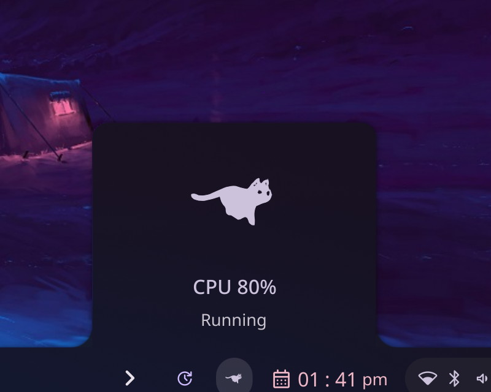

# Cat

An animated cat that lives in the bar. It sleeps while the machine is idle, walks
as the CPU picks up, and breaks into a full sprint under heavy load — drawn in the
theme's secondary colour, or in any colour you pick.

A port of the Noctalia plugin of the same name by DotNetRob, to Caelestia on KDE
Plasma, using the same glyph font, the same pacing and the same default settings.



Clicking the widget opens a panel with the same cat, panel-sized, plus the live
percentage:



## Requirements

- Caelestia shell 2.6.3 or newer, with the bar enabled.

Nothing else: no packages, no downloads, no helper scripts.

## Usage

Add **Cat** to a bar from Nexus → Bar, or by hand in `shell.json`:

```json
"entries": [
  { "enabled": true, "id": "cat", "zone": "right" }
]
```

Click the cat to toggle its panel; click anywhere else to dismiss it. The panel can
also be toggled over IPC, which is handy for scripts and keybinds:

```sh
caelestia-shell-ipc call cat panel
caelestia-shell-ipc call cat status
```

`status` returns the frame currently on screen:

```json
{"pace":"run","glyph":"d","cpuPercent":74,"catSize":24,"showCpuPercent":false,
 "colourMode":"theme","fontFamily":"Noctalia Catwalk 2"}
```

## Settings

Settings live in Nexus → Plugins → Cat. Changing one rebuilds the plugin and takes
effect within a second; the shell does not need a restart.

| Setting | Type | Default | Description |
| --- | --- | --- | --- |
| Cat size | number 12-48 | 24 | Sprite size in the bar, in pixels. |
| Show CPU percentage | toggle | off | Print the current usage next to the cat. |
| Walk threshold | number 0-100 | 15 | CPU percentage at which the cat wakes up and starts walking. |
| Run threshold | number 0-100 | 60 | CPU percentage at which the cat breaks into a run. |
| CPU poll interval | number 1-10 | 2 | How often to sample CPU usage, in seconds. |
| Cat color | enum | theme | `theme` follows the palette's secondary colour; `custom` uses the colour below. |
| Custom color | text | `#E8A24C` | `#RGB`, `#RRGGBB` or `#AARRGGBB`. Ignored unless Cat color is `custom`. |

## How it works

1. Every **CPU poll interval** seconds the plugin re-reads `/proc/stat` and compares
   the aggregate `cpu` line with the previous reading. Usage is the share of the
   counters that was neither idle nor waiting; the first reading only establishes a
   baseline, so the cat is asleep for the first second after the shell starts.
2. Between samples the cat advances its run cycle on an 80 ms tick. The pace maps
   usage onto a frame duration: idle stays on the sleeping glyph, walking ramps from
   a 380 ms to a 180 ms frame, running from 160 ms down to 55 ms. Above the run
   threshold the cycle keeps speeding up until 100 %.
3. The bar widget and the popout both draw the frame published by that service, so
   the big cat runs in step with the small one.

The shape comes from `catwalk2.otf`, a pictographic font: `a` is the sleeping cat and
`b`-`f` are the five run frames. Being a font rather than an image, the cat takes the
theme colour like any other bar text.

## Limitations

- The bar is 40 px thick by default, so sizes above roughly 34 px get clipped by the
  bar row. The setting is left as wide as upstream's because bars can be scaled.
- Usage is the whole-machine average, not per core, and the sampling window is the
  poll interval: a burst shorter than that is averaged away.
- With `show_cpu_percent` off there is no number on screen; the pace is only visible
  as motion. Turn it on, or use the panel, to see the reading.
- The pace words in the panel ("Asleep", "Walking", "Running") are translated; the
  glyphs are not tied to any language.

## Privacy

Reads `/proc/stat` and the plugin's own settings file. Nothing is downloaded, no
processes are started, and nothing leaves the machine.

## Licensing

MIT, see [LICENSE](LICENSE). The original Noctalia plugin is MIT as well. The bundled
`catwalk2.otf` is the upstream font, traced from the MIT-licensed
[CatWalk](https://store.kde.org/p/2055225) plasmoid by Driglu4it.
